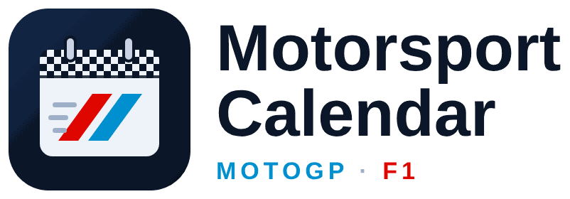

<p align="center">
  
</p>

<p align="center">
  <a href="https://github.com/hacs/integration"></a>
  
  
</p>

# Motorsport Calendar for Home Assistant

Two calendars, **MotoGP** and **Formula 1**, with every session at the right time in your own time zone.

- `calendar.motogp`: free practice, practice, qualifying, sprint, warm-up and race, from the **official MotoGP data** (the feed used by motogp.com and the MotoGP app).
- `calendar.f1`: practice, qualifying, sprint qualifying, sprint and race, from **[OpenF1](https://openf1.org)** (open data from the official F1 timing feed).

Every session has an exact UTC time from its source, so there are no time zone or daylight-saving mistakes. When a round is moved, the calendar follows within six hours.

## Features

- Two calendar entities that work everywhere a Home Assistant calendar works: the Calendar panel, calendar cards (e.g. [Calendar Card Pro](https://github.com/alexpfau/calendar-card-pro)) and **calendar triggers** in automations.
- Session names in **English or French** (chosen when adding the integration, changeable later in its options; defaults to your Home Assistant language) (`🏍️ MotoGP Qatar – Race` / `🏍️ MotoGP Qatar – Course`).
- The current season, plus the next one as soon as it is published.
- Updates every 6 hours and keeps the last schedule on disk, so calendars still work if a source is briefly down or Home Assistant restarts offline.
- No account, no API key: the only setting is the language.

## Installation

### HACS (recommended)

1. HACS → ⋮ → **Custom repositories** → add `https://github.com/Flodu31/ha-motorsport-calendar`, category **Integration**.
2. Install **Motorsport Calendar**, then restart Home Assistant.
3. **Settings → Devices & services → Add integration → Motorsport Calendar**.

### Manual

Copy `custom_components/motorsport_calendar` into your `config/custom_components/` folder, restart Home Assistant, then add the integration as above.

## Entities

| Entity | Content | Source |
|---|---|---|
| `calendar.motogp` | MotoGP class sessions of every Grand Prix | api.motogp.pulselive.com |
| `calendar.f1` | Formula 1 sessions of every Grand Prix | api.openf1.org |

Each event has:

- **summary**: `🏎️ F1 Las Vegas – Qualifying`
- **location**: the circuit
- **description**: `Series: F1` / `GP: Las Vegas` / `Session: qualifying`

The `Session:` line is always one of `practice`, `qualifying`, `sprint`, `warm_up` or `race`, in every language, so automations can filter on it.

## Example: notification 5 minutes before each session

```yaml
alias: Motorsport – 5 min before
triggers:
  - trigger: calendar
    entity_id: calendar.f1
    event: start
    offset: "-0:05:00"
  - trigger: calendar
    entity_id: calendar.motogp
    event: start
    offset: "-0:05:00"
conditions:
  # every session except warm-up
  - condition: template
    value_template: >
      {{ trigger.calendar_event.description is search('Session: (practice|qualifying|sprint|race)') }}
actions:
  - action: notify.mobile_app_my_phone
    data:
      message: >
        {{ trigger.calendar_event.summary }} starts at
        {{ as_local(as_datetime(trigger.calendar_event.start)).strftime('%H:%M') }}
mode: queued
```

## Data sources

- **MotoGP**: `https://api.motogp.pulselive.com/motogp/v1/events?seasonYear=YYYY`, the public feed behind motogp.com. Only sessions of the MotoGP class are kept (no Moto2/Moto3, no media events).
- **F1**: `https://api.openf1.org/v1/sessions` and `/v1/meetings`. OpenF1 is a community project and is not affiliated with Formula 1.

This integration only reads public schedules, a few requests every 6 hours.

## Disclaimer

This project is not affiliated with, endorsed by or connected to Dorna Sports, MotoGP™, Formula 1®, the FIA or OpenF1. MotoGP and F1 are trademarks of their respective owners.

## License

[MIT](LICENSE)

---

### 🇫🇷 En bref

Deux agendas pour Home Assistant, **MotoGP** (données officielles motogp.com) et **F1** (OpenF1), avec toutes les séances à la bonne heure. Noms des séances en français ou en anglais au choix : « 🏍️ MotoGP Qatar – Course ». Installation via HACS (dépôt personnalisé) puis **Paramètres → Appareils et services → Ajouter → Motorsport Calendar**.
